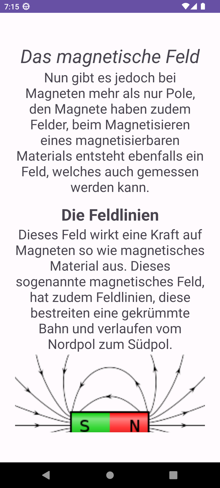
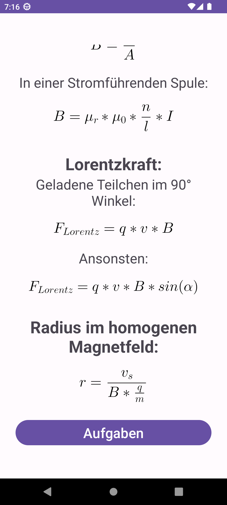
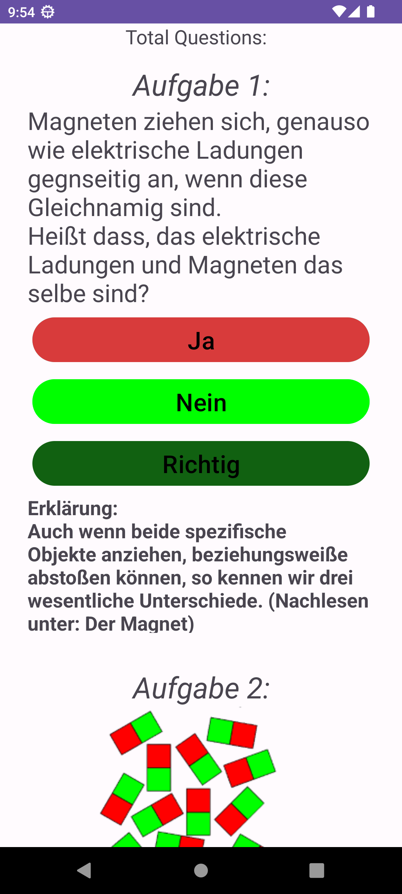
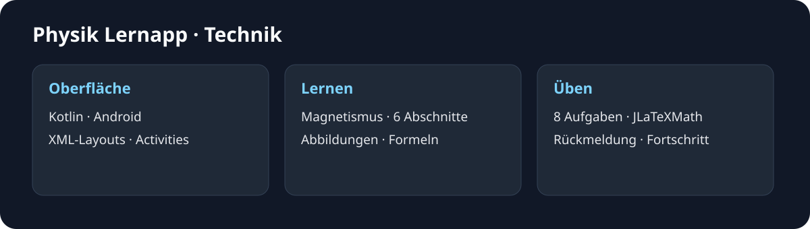

# Physik Lernapp

**Android · Kotlin · Magnetismus · Schulprojekt / 2023**

Physik zum Nachlesen und Ausprobieren: Die Android-App verbindet ein illustriertes Magnetismuskapitel mit Formeln und kurzen Übungsaufgaben. Sie entstand 2023 als Ersatzleistung für eine schriftliche Physikprüfung.

| Lernen | Formeln | Üben |
| --- | --- | --- |
|  |  |  |

[**APK-Paket herunterladen**](https://github.com/Kennatris/Seminararbeit_Physik_Lernapp/raw/refs/heads/master/downloads/Physik-Lernapp-1.0-Android.zip) · [Alle App-Bilder](docs/GALERIE.md) · [Projekt und Technik](docs/PROJEKT.md)

## Das steckt in der App

- Sechs Lernabschnitte über Magnete, Feldlinien, stromdurchflossene Leiter, Lorentzkraft, Teilchenbewegung und Formeln.
- Abbildungen zu Ladungen, Magneten und den Handregeln.
- Mathematisch gesetzte Gleichungen mit JLaTeXMath.
- Acht leichte Aufgaben mit Auswahlantworten und Zahleneingabe.
- Farbige Rückmeldungen, eine Erklärung zur ersten Frage und Fortschrittsanzeigen.

## Ausprobieren

Das ZIP enthält die APK, die Originalquellen, Drittanbieter-Lizenzen und Prüfsummen. Nach dem Entpacken lässt sich die APK auf einem Android-Gerät öffnen. Es handelt sich um eine Demo mit Debug-Signatur. Die Aufnahmen zeigen Android 13 mit 1080 × 2400 Pixeln. Auf kürzeren Displays kann die feste Oberfläche Inhalte abschneiden.

Umgesetzt sind das Magnetismuskapitel und die leichten Aufgaben. Weitere Einträge der Themen- und Schwierigkeitsauswahl besitzen keine eigenen Lernseiten. [Installation, Bedienung und Build](docs/PROJEKT.md) · [Lizenzen](docs/LIZENZEN.md).

> **Hinweis:** Dokumentation und Zusammenfassung wurden automatisiert durch einen Agenten erstellt und dienen der Veranschaulichung. Der Programmcode ist unverändert. Alle Angaben und Downloads ohne Gewähr.
