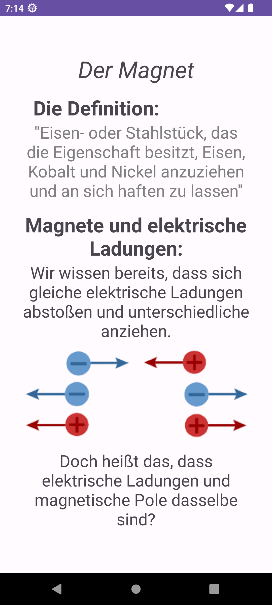
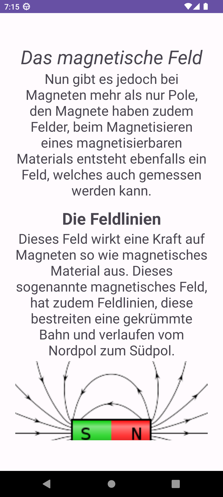
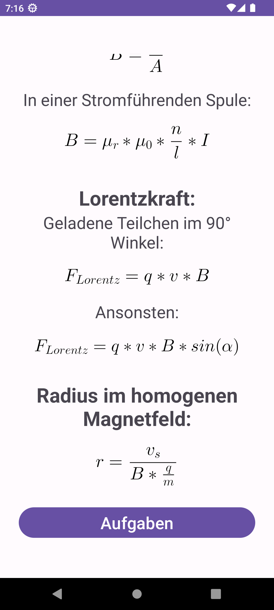
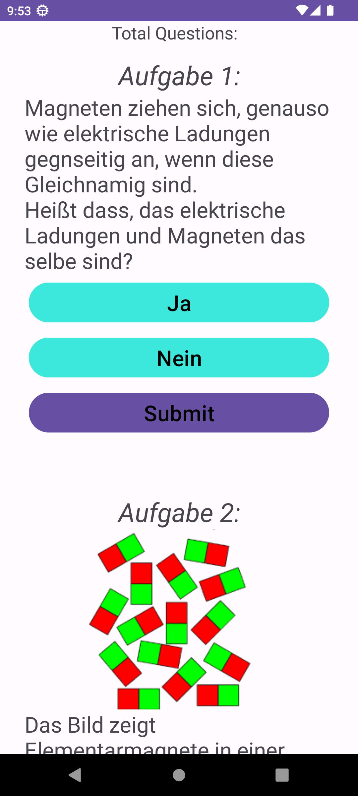
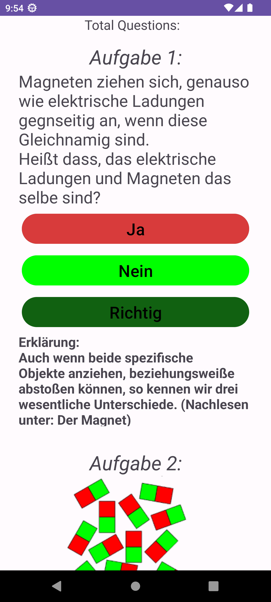
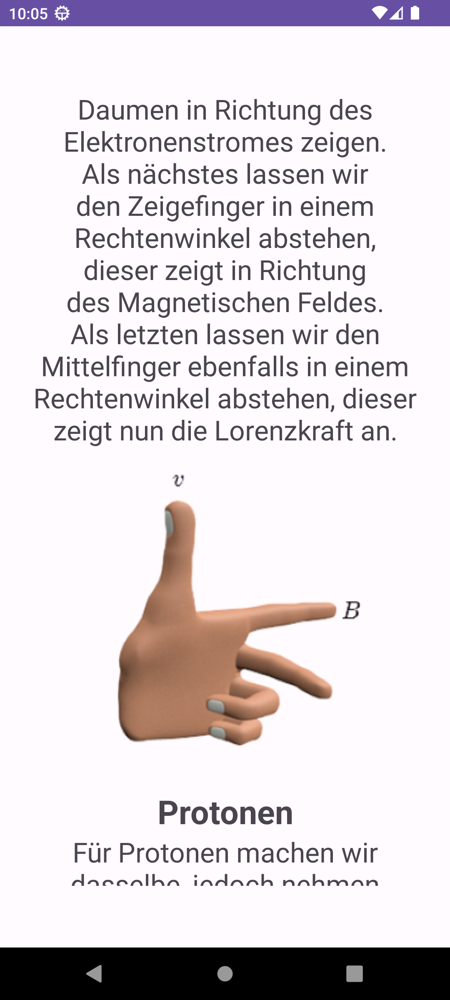

# Physik Lernapp – Bildergalerie

[Zur Einführung](../README.md) · [Projekt und Bedienung](PROJEKT.md)

Die 16 Aufnahmen zeigen die laufende, unveränderte App auf Android 13 mit 1080 × 2400 Pixeln. Texte und Abbildungen entsprechen dem Originalprojekt.

| Start | Themenauswahl |
| --- | --- |
|  |  |
| Der Einstieg in die Lernapp. | Auswahl des ausgearbeiteten Magnetismuskapitels. |

| Kapitelübersicht | Magnete und Ladungen |
| --- | --- |
|  |  |
| Direkte Sprünge zu den Lernabschnitten. | Anziehung und Abstoßung mit der ursprünglichen Abbildung. |

| Magnetische Feldlinien | Teilchen im Magnetfeld |
| --- | --- |
|  |  |
| Text und Feldliniendarstellung eines Stabmagneten. | Lorentzkraft und Zentripetalkraft als gesetzte Gleichungen. |

| Formelsammlung | Schwierigkeitsauswahl |
| --- | --- |
|  |  |
| Spulenfeld, Lorentzkraft und Radius einer Kreisbahn. | Der Aufgabenbereich wird über Leicht geöffnet. |

| Auswahlaufgaben | Richtige Antwort |
| --- | --- |
|  |  |
| Erste Frage und Abbildung zur Magnetisierung. | Farbige Rückmeldung und Erklärung zur ersten Aufgabe. |

| Zahleneingabe | Falsche Antwort |
| --- | --- |
|  |  |
| Drei Zahlenräder und zwei Fortschrittsanzeigen. | Erwarteter Zahlenwert und aktualisierter Fortschritt. |

| Feldlinien bestimmen | Linke-Hand-Regel |
| --- | --- |
|  |  |
| Auswahlfrage zum Magnetfeld am Leiter. | Lerntext und ursprüngliche Handgrafik. |

| Lorentzkraft | Dreifingerregel |
| --- | --- |
|  |  |
| Einführung zur Kraft auf Elektronen und Protonen. | Geschwindigkeit und Feldrichtung in der Handgrafik. |

Alle Angaben ohne Gewähr.
