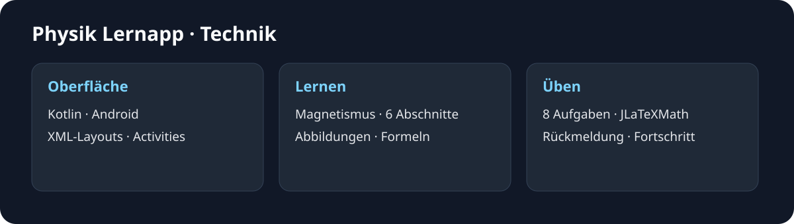

# Physik Lernapp – Projekt und Technik

[Zur Einführung](../README.md) · [Bildergalerie](GALERIE.md)

## Idee und Lerninhalte

Die App bringt Erklärungen und Übungen auf das Smartphone. Das Schulprojekt von 2023 behandelt Magnetismus und entstand als Ersatzleistung für eine schriftliche Physikprüfung.

| Abschnitt | Inhalt |
| --- | --- |
| Der Magnet | Magnetische Pole, elektrische Ladungen und Elementarmagnete |
| Das magnetische Feld | Feldlinien, ihre Richtung und die Darstellung eines Stabmagneten |
| Magnetfelder ohne Magnete | Strom als Ursache eines Magnetfelds und die Linke-Hand-Regel |
| Die Lorentzkraft | Kraft auf Elektronen und Protonen, Dreifingerregel und Formeln |
| Elementarteilchen im Magnetfeld | Lorentz- und Zentripetalkraft, Kreisbahn und Bahnradius |
| Formeln | Ladung, Flussdichte, Spulenfeld, Lorentzkraft und Bahnradius |

Das Inhaltsverzeichnis springt direkt zum gewählten Abschnitt. Der Lerntext bleibt als zusammenhängende, vertikal scrollbare Seite zugänglich.

## Übungen und Bedienung

1. Auf dem Startbildschirm **Start** wählen.
2. **Das magnetische Feld** auswählen und öffnen.
3. Einen Lernabschnitt antippen oder durch die Seite blättern.
4. Über **Aufgaben** und **Leicht** zu den Übungen wechseln.
5. Eine Antwort auswählen oder die Zahlenräder bedienen und mit **Submit** abgeben.

Sieben Aufgaben verwenden Auswahlantworten, die achte eine Zahleneingabe. Die Fragen behandeln Magnetisierung, Feldlinien und Handregeln sowie eine Rechnung zur Lorentzkraft. Nach der Abgabe markiert die App die richtigen und falschen Möglichkeiten farbig. Bereits abgegebene Antworten werden gesperrt. Bei der ersten Aufgabe erscheint zusätzlich eine Erklärung. Eine falsche Zahleneingabe wird auf den erwarteten Wert gesetzt.

Zwei Fortschrittsanzeigen zählen die bearbeiteten und die richtig gelösten Aufgaben. Die Oberfläche verwendet dafür ihre ursprüngliche Skala von zehn Aufgaben, während acht Aufgaben implementiert sind. Die Schwierigkeitsauswahl enthält auch **Mittel** und **Schwer**. Mit einer eigenen Aufgabenseite verbunden ist **Leicht**. In der Themenauswahl führt **Das magnetische Feld** zu den Lerninhalten, die anderen Einträge öffnen erneut die Auswahl.

## Android-Paket

[**APK-Paket herunterladen (ZIP)**](../downloads/Physik-Lernapp-1.0-Android.zip) · [SHA-256 des ZIP](../downloads/Physik-Lernapp-1.0-Android.zip.sha256)

| Eigenschaft | Wert |
| --- | --- |
| App-Version | 1.0 |
| Paketname | <code>com.tinostrasser.seminararbeit_physik_lernapp</code> |
| Mindestversion laut Manifest | Android 5.0 / API 21 |
| Zielversion | Android 13 / API 33 |
| Signatur | Android-Debug-Zertifikat, APK-Signaturschema v1 und v2 |
| Ausprobierte Umgebung | Android-13-Emulator, 1080 × 2400 Pixel, Hochformat |

Das ZIP enthält <code>Physik-Lernapp-1.0.apk</code>, eine kurze Anleitung, die App-Quellen, den vollständigen Quellstand von JLaTeXMath 0.2.0 und die zugehörigen Lizenzhinweise. <code>SHA256SUMS.txt</code> enthält die Prüfsummen der Paketbestandteile.

Das Paket entpacken und die APK auf dem Android-Gerät öffnen. Die App benötigt laut Manifest keine Internetberechtigung. Es gibt weder ein Benutzerkonto noch einen eigenen Server. Die feste Anordnung der Oberfläche ist auf hohen Displays am besten lesbar. Die angegebene Mindestversion allein garantiert keine passende Darstellung auf jedem Gerät.

## Aufbau

| Datei oder Ordner | Aufgabe |
| --- | --- |
| MainActivity.kt | Einstieg mit Startschaltfläche |
| SelectScreen.kt | Themenauswahl und Weiterleitung |
| MagnetischeFeld.kt | Abschnittsnavigation und mathematische Formeln |
| MagnetischeFeldAufgaben.kt | Schwierigkeitsauswahl |
| MFA_Leicht.kt | Acht Aufgaben, Auswertung und Fortschrittsanzeigen |
| app/src/main/res/layout | XML-Oberflächen der fünf Activities |
| app/src/main/res/drawable | Abbildungen und Oberflächenelemente |
| app/src/test und app/src/androidTest | Ursprüngliche Beispieltests |

Die Anwendung verwendet Kotlin und klassische Android-Activities mit XML-Layouts. AndroidX, Material Components und ConstraintLayout bilden die Oberfläche. JLaTeXMath und seine zusätzlichen Schriftmodule setzen die Gleichungen. Die Aufgaben werden innerhalb der Activity ausgewertet. Eine dauerhafte Speicherung des Übungsfortschritts ist nicht implementiert.

## Selbst bauen

Benötigt werden **JDK 17**, **Gradle 8.0**, **Android SDK Platform 33** und **Android Build Tools 30.0.3**. Die Build-Konfiguration verwendet Android Gradle Plugin 8.0.0 und Kotlin 1.8.0.

Mit einer installierten Gradle-8.0-Distribution im Projektordner:

<pre>gradle testDebugUnitTest assembleDebug</pre>

Das Android-SDK muss über die lokale Entwicklungsumgebung oder <code>ANDROID_HOME</code> verfügbar sein. Die APK liegt anschließend unter <code>app/build/outputs/apk/debug/app-debug.apk</code>. Der Build und die vorhandenen Unit-Tests wurden mit unveränderten Programmquellen ausgeführt. Die Geräteansichten stammen aus der laufenden App im Emulator.

## Bibliotheken und Medien

[Lizenztexte, Bibliotheksquellen und Hinweise](LIZENZEN.md) beschreiben die mitgelieferten Komponenten. Die Galerie zeigt die originale Darstellung einschließlich ihrer Texte und Abbildungen.

Alle Angaben und Downloads ohne Gewähr.
